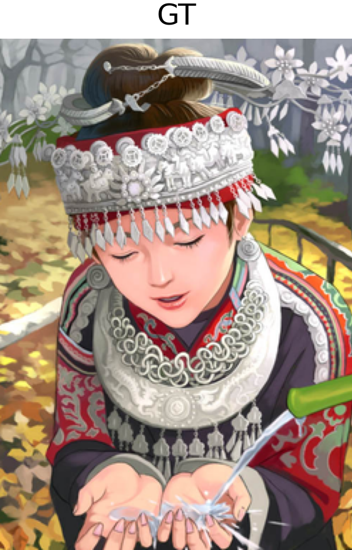
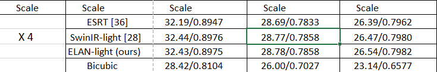

<div align="center">

# LDAT: A Lightweight Dual Aggregation Transformer for Image Super-Resolution

**A 738K-parameter transformer for ×4 single-image super-resolution, combining spatial-window and channel-wise self-attention.**


[Project Report (PDF)](minor_project_Report.pdf) · [Original DAT Paper](https://arxiv.org/abs/2308.03364)

</div>

---

## Highlights

- Designed and trained a **lightweight variant of the Dual Aggregation Transformer (DAT)** with **738K parameters**, about **17.7% fewer than SwinIR-light** (897K).
- Reaches **32.37 dB PSNR on Set5 (×4)**, within **0.07 dB of SwinIR-light**, with a smaller model.
- Trained from scratch on **DF2K** (DIV2K + Flickr2K) for 360 epochs on **2× NVIDIA T4 GPUs**.
- Benchmarked on **Set5, Set14 and Urban100** against ESRT, SwinIR-light and ELAN-light.
- Written up as a full B.E. minor project report (Tribhuvan University, IOE Purwanchal Campus).

## Motivation

State-of-the-art super-resolution models such as SwinIR and ESRGAN deliver excellent quality, but their size and compute cost make them hard to deploy on mobile and edge devices. Pure CNN models are cheap, but they mainly capture local features and struggle to model long-range dependencies.

**Goal:** keep the global modelling ability of transformers while cutting parameters and memory, so that high-quality SR becomes practical for resource-constrained settings.

## Method

LDAT follows the DAT design (Chen et al., ICCV 2023) with a reduced configuration. It has three stages: shallow feature extraction, deep feature extraction, and HR reconstruction.

| Component | Role |
|---|---|
| **Shallow feature extraction** | A convolution maps the LR image into feature space. |
| **Residual Groups (RGs)** | Stack Dual Aggregation Transformer Blocks (DATBs) with residual connections for stable training. |
| **DSTB** (Dual Spatial Transformer Block) | Spatial window self-attention (SW-SA) captures spatial dependencies. |
| **DCTB** (Dual Channel Transformer Block) | Channel-wise self-attention (CW-SA) models global channel relationships. |
| **AIM** (Adaptive Interaction Module) | Fuses global self-attention with local convolution features. |
| **SGFN** (Spatial-Gate Feed-Forward Network) | Spatial gating with depth-wise convolutions to refine features and reduce channel redundancy. |
| **Reconstruction** | Convolutions plus pixel shuffle for efficient upsampling. |

**Dual feature aggregation** happens at two levels:

1. **Inter-block:** DSTB and DCTB alternate, so spatial and channel information are learned in a complementary way.
2. **Intra-block:** AIM and SGFN couple local and global information inside each block.

### Lightweight configuration

| Hyper-parameter | Value |
|---|---|
| Residual groups | 4 |
| DATB pairs (DSTB + DCTB) per group | 2 |
| Channel dimension | 60 (original DAT: 180) |
| Attention heads | 4 |
| SGFN channel expansion factor | 3 |
| Spatial window size | 8 × 16 |
| Total parameters | **738K** |

## Experimental Setup

| Item | Details |
|---|---|
| Training data | DF2K: 800 DIV2K + 2,650 Flickr2K images |
| Validation | First 10 images of the DF2K validation set (to speed up each epoch) |
| Test sets | Set5, Set14, Urban100 |
| Upscaling factor | ×4 |
| Patch size / batch size | 64×64 / 16 for 215 epochs, then 32 up to 360 epochs |
| Optimizer / loss | Adam / L1 loss |
| Learning rate | 5e-4, halved at epochs 80, 130, 160, 180, 250, 260, 300 |
| Augmentation | Random 90°/180°/270° rotations, horizontal flips |
| Framework / hardware | PyTorch, 2× NVIDIA T4 |

## Results


### Qualitative: Visual Comparisons

Sample results from LDAT:

<p align="center">
  
  
  
</p>

### Comparison with Other Models

<p align="center">
  
</p>

LDAT recovers sharper edges and window/grid structures than bicubic interpolation, with minimal artifacts.

### Training dynamics

Training and validation loss converge smoothly. Validation PSNR rises from about 28.6 dB to about 30.5 dB over the 360 epochs, with SSIM reaching about 0.836. These figures are on the 10-image DF2K validation subset, so they are not comparable with the benchmark numbers above. Curves are in the [report](minor_project_Report.pdf) (Section 4.4).

## Limitations and Future Work

- LDAT is still more compute- and memory-hungry than lightweight **CNN-based** SR models.
- Performance on Urban100 trails ELAN-light and SwinIR-light; longer training, a larger patch size and distillation are natural next steps.
- Planned: more efficient attention implementations, quantization/pruning for edge deployment, and extension to other low-level vision tasks such as denoising and deblurring.
- Medical and remote-sensing imagery are important SR application areas and have not yet been evaluated.

## Repository Structure

```
.
├── model/              # LDAT architecture (DSTB, DCTB, AIM, SGFN, reconstruction)
├── dataset/            # Data loading and augmentation
├── utilities/          # Metrics (PSNR/SSIM) and helper functions
├── results/            # Qualitative results and figures
├── model_train.py      # Training script
├── main.py             # Entry point / inference
└── minor_project_Report.pdf
```

## Getting Started

```bash
git clone https://github.com/arjelmilan/Image-super-Resolution-.git
cd Image-super-Resolution-
pip install torch torchvision numpy pillow
```

**Train**

```bash
python model_train.py
```

**Run / evaluate**

```bash
python main.py
```

Datasets: [DIV2K](https://data.vision.ee.ethz.ch/cvl/DIV2K/) and Flickr2K, evaluated on Set5, Set14 and Urban100.

## Team

Developed as a B.E. Computer Engineering minor project at the Department of Electronics and Computer Engineering, IOE Purwanchal Campus, Tribhuvan University, under the supervision of Asst. Prof. Pukar Karki.

- Milan Arjel
- Samir Bidari
- Sandeep Poudel
- Sandesh Pokharel

## References

1. Z. Chen, Y. Zhang, J. Gu, L. Kong, X. Yuan, et al. *Dual Aggregation Transformer for Image Super-Resolution.* ICCV 2023. [arXiv:2308.03364](https://arxiv.org/abs/2308.03364)
2. J. Liang et al. *SwinIR: Image Restoration Using Swin Transformer.* [arXiv:2108.10257](https://arxiv.org/abs/2108.10257)
3. Z. Lu et al. *Transformer for Single Image Super-Resolution (ESRT).* [arXiv:2108.11084](https://arxiv.org/abs/2108.11084)
4. X. Zhang et al. *Efficient Long-Range Attention Network for Image Super-Resolution (ELAN).* [arXiv:2203.06697](https://arxiv.org/abs/2203.06697)
5. R. Timofte et al. *NTIRE 2017 Challenge on Single Image Super-Resolution* (DIV2K). CVPRW 2017.
6. B. Lim et al. *Enhanced Deep Residual Networks for Single Image Super-Resolution* (Flickr2K). CVPRW 2017.

## Acknowledgements

This work builds on the official DAT design by Chen et al. LDAT is a reduced-size re-implementation and training study, not the original authors' code.
